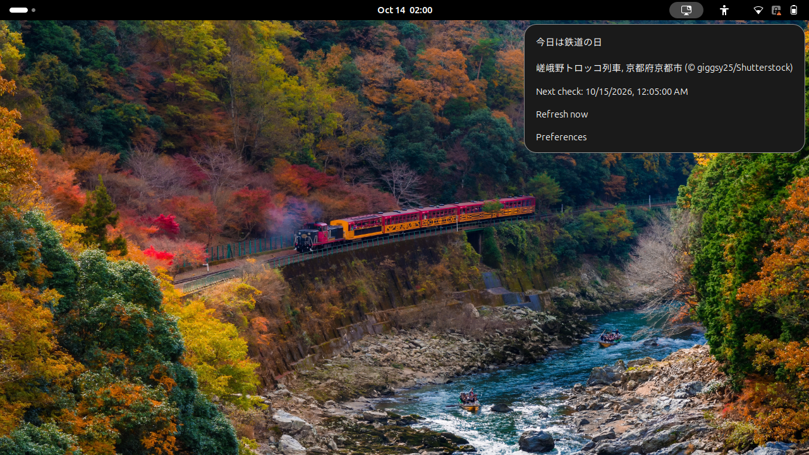
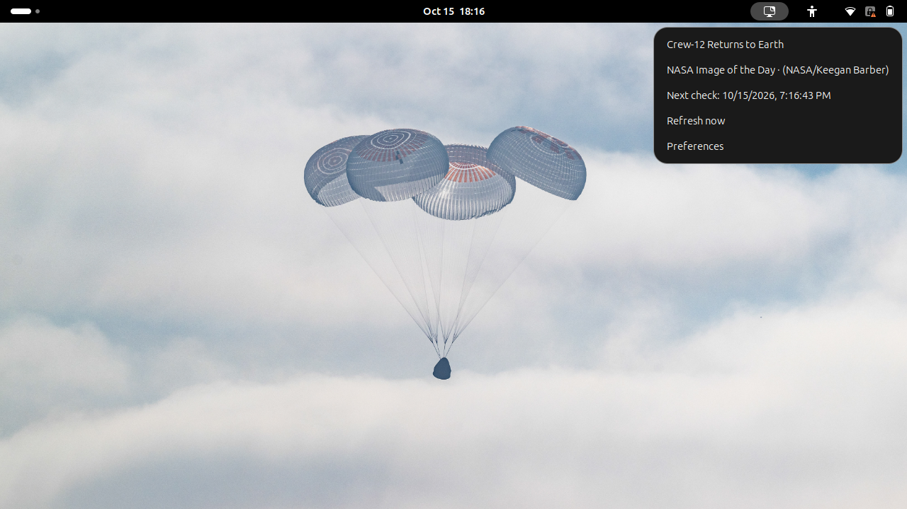

# GNOME Wallpaper

[日本語](README.ja.md)

Wallpapers from Bing, NASA Image of the Day, or your own image folder. GNOME Wallpaper changes your background automatically and shows the photo's title and credit in the top panel.

It works with **GNOME Shell 50**, with the same photo for light and dark themes.

An actual GNOME Shell 50 session. Open the wallpaper icon in the top panel for photo information, choose **Refresh now** to update, or open **Preferences** to choose the source and Bing region/resolution. Credits are displayed in the menu.

## What you can do

- Let your wallpaper update each day, or choose **Refresh now** whenever you like.
- Choose Bing, NASA Image of the Day, or My images. Bing supports regions such as Japan or the US, and UHD or 1920×1080 images.
- Keep your current wallpaper when a download fails. The extension will try again automatically.
- Turn it off to return to your previous wallpaper. If you changed the wallpaper yourself, it keeps your choice.

## Getting started

This is an early development version. In addition to automated checks, a separate GNOME Shell 50 session can verify live Bing and NASA retrieval, wallpaper rendering, and panel information. A release and regular installation guide are still pending.

In a development environment, use `just gnome` to open a desktop and try the extension. See [Local GNOME smoke testing](docs/GNOME.md) for prerequisites and instructions.

Once installed, enable **Daily Wallpaper** in your extension manager. It fetches the latest photo automatically.

Open the wallpaper icon in the top panel to see the photo's name, credit, and update status. Choose **Refresh now** for an immediate update, or **Preferences** to change:

- **Source**: Bing (default), NASA Image of the Day, or My images. No API key is needed.
- **Market**: the Bing region; the default is `ja-JP` (Japan). Try `en-US` for the US.
- **Resolution**: UHD by default, or 1920×1080. If UHD is unavailable, it uses Bing's regular image.

Market and Resolution apply only to Bing. NASA uses the latest suitable original image from its 20 most recent entries: JPEG/PNG, at least 1920×1080, and width/height between 1.45 and 2.4. It may keep the same photo across several days; it never substitutes a different source on failure. Images use GNOME’s existing display settings.

NASA example: [Crew-12 Returns to Earth](https://www.nasa.gov/image-detail/nasas-spacex-crew-12-splashdown-2/), NASA/Keegan Barber. The screenshot shows the image selected by the extension, not necessarily today’s entry.

The controls are in English. Bing photo information follows the selected region; NASA information is in English. Bing/NASA downloads require an internet connection; My images works offline. If an update fails, you can wait for the next attempt or select **Refresh now**.

## Use your own images

Choose **Preferences → Source → My images**, then place JPEG, PNG, or WebP files directly in the displayed folder. Its usual location is **`~/.local/share/gnome-wallpaper/self/`**. With `XDG_DATA_HOME` set, it uses `$XDG_DATA_HOME/gnome-wallpaper/self/`. **Open folder** opens it, creating an empty folder if necessary.

Images cycle once per local day in numeric filename order, for example `image1.jpg` → `image2.png` → `image10.webp`, then back to the first file. The first run starts with the first image; subsequent changes are scheduled at local midnight. Restarting or switching sources on the same day keeps the same image. Several inactive days advance only one image. Resume from sleep also checks the date.

After adding or deleting files, choose **Refresh now** to rescan. It keeps the day's image; if that file disappeared, it selects the first remaining readable image. Subfolders are ignored. There are no size or aspect-ratio restrictions; GNOME's display settings control presentation. Broken or unreadable images are skipped. If none are usable, the extension retains the wallpaper settings, shows an error, and retries.

The extension directly references these files and never copies, edits, or deletes them. Manage them in your file manager.

## Saved photos

Bing/NASA photos are saved in `~/.local/share/gnome-wallpaper` by default and reused when possible. Old photos are cleaned up automatically; photos still needed for your wallpaper are kept. Turning the extension off leaves the saved photos in place.

## License and inspiration

The code and documentation use the [MIT license](LICENSE). Photographs have their own rights and credits. Bundled libraries retain their licenses; the ZIP includes `THIRD_PARTY_LICENSES.txt`.

Inspired by [Bing Wallpaper GNOME Extension](https://github.com/neffo/bing-wallpaper-gnome-extension), with an independently written implementation.
